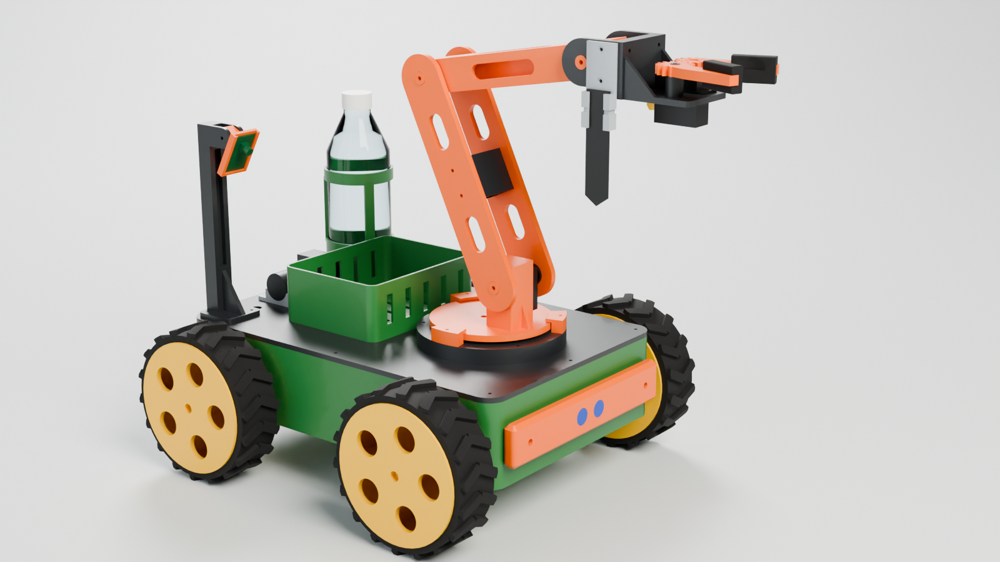
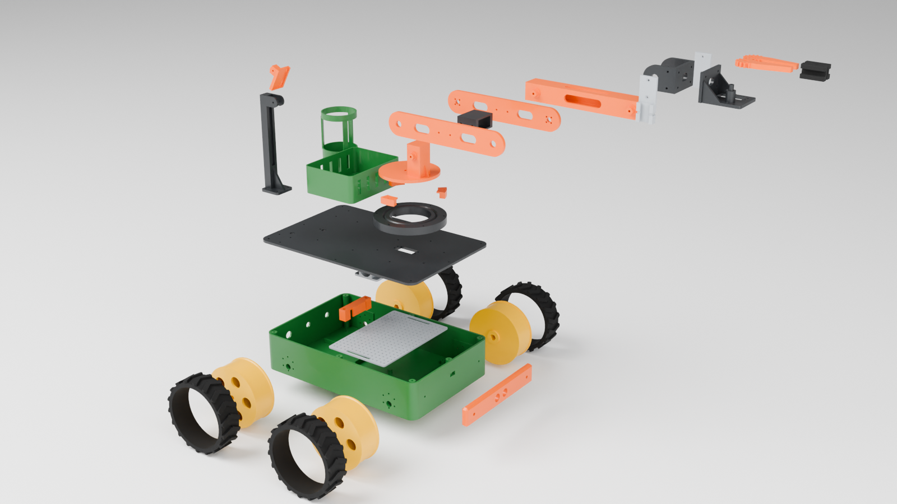
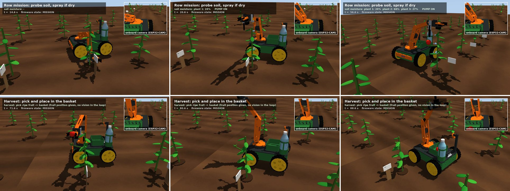
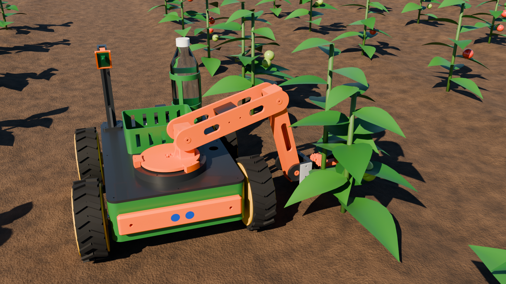

# AgroBot Mk1

[](https://github.com/jitendraphand/agrobot/actions/workflows/ci.yml)

A 3D-printable four-wheel field robot with a 4-axis arm for small-plot
agriculture: it drives along a crop row, pushes a moisture probe into the
soil beside each plant, spot-sprays the dry ones, and can pick small
produce into a basket on its deck.



Everything is generated from one parameter file
([`cad/agrobot_cad/params.py`](cad/agrobot_cad/params.py)): the STEP / STL
files, the physics model, the Blender scenes and the geometry header the
firmware compiles against.

> **Status: a complete design that has been simulated but not built.** No
> part has been printed and no board has been wired. Read
> [What is verified](#what-is-verified) before ordering parts.

## What is in the repository

| Folder | Contents |
|---|---|
| [`cad/`](cad/) | Parametric CadQuery source. `cad/export/step` and `cad/export/stl` hold 26 printable part files, already in print orientation; `agrobot_assembly.step` is the whole robot |
| [`electronics/`](electronics/) | [Bill of materials](electronics/BOM.md) with Indian sourcing and a rupee budget; [wiring](electronics/wiring.md) with pin map and power tree |
| [`firmware/`](firmware/) | ESP32 firmware (PlatformIO, no external libraries), a portable control core with unit tests, the web control panel |
| [`simulation/`](simulation/) | MuJoCo models generated from the CAD, firmware-in-the-loop scenarios, videos and reports in `simulation/output/` |
| [`blender/`](blender/) | Script that builds the `.blend` scenes in `blender/scenes/`; renders in `blender/renders/` |
| [`docs/`](docs/) | [Printing](docs/printing.md), [assembly](docs/assembly.md), [firmware](docs/firmware.md), [simulation](docs/simulation.md), [design notes](docs/design_notes.md) |

## The robot

| | |
|---|---|
| Size | 410 x 366 mm footprint, about 350 mm tall with the arm stowed |
| Mass | about 5.2 kg ready to work |
| Drive | 4 x JGB37-520 12 V gear motors, 150 mm TPU-tyred wheels, skid steer, up to 0.4 m/s |
| Arm | Base yaw, shoulder, elbow, wrist pitch + two-finger gripper; 200 + 180 + 130 mm links |
| Reach | 0.51 m from the shoulder; probes the ground about 0.3 m to either side of the centre line |
| Payload | 150 g at full reach (1.6x servo torque margin), about 250 g close in |
| Tools | Gripper with dished TPU pads, capacitive soil-moisture probe, misting nozzle fed by a 12 V pump from a 500 ml bottle |
| Controller | ESP32 DevKit V1, PCA9685 servo driver, 2 x BTS7960 motor drivers, MPU6050, optional ESP32-CAM |
| Power | 3S Li-ion 11.1 V 5200 mAh, roughly 1.5 h of mixed work |
| Printing | 26 files, 35 pieces, about 2.3 kg PETG + 0.5 kg TPU; largest part 380 x 250 x 80 mm |
| Budget | about Rs 18,500 - 33,000 including filament ([breakdown](electronics/BOM.md#budget)) |



## Simulation

The simulator runs the **same C++ control code that is flashed to the
ESP32**, compiled as a shared library, against a MuJoCo model built from the
CAD meshes. Commands go in through the firmware's own text protocol.

| Video | What happens |
|---|---|
| [`simulation/output/row_mission.mp4`](simulation/output/row_mission.mp4) | `ROW 3 610 600 335`: drive to three plants, probe each, spray the two dry ones; then `PICK`: take a 42 mm fruit off its truss and drop it in the basket |
| [`simulation/output/terrain_test.mp4`](simulation/output/terrain_test.mp4) | 2.5 m over 25 mm ridges, up a 12 degree ramp, a 180 degree turn on the spot, back down |
| [`blender/renders/agrobot_mission_anim.mp4`](blender/renders/agrobot_mission_anim.mp4) | The row mission replayed in Blender from the simulation trajectory (time-lapse) |



RESULTS_SUMMARY



## Build it

1. **Check the parts list**: [electronics/BOM.md](electronics/BOM.md). Buy
   the servos, horn discs and motors first and measure them against the
   table in [docs/printing.md](docs/printing.md#tolerances-you-will-probably-need-to-tune).
2. **Print**: [docs/printing.md](docs/printing.md).
3. **Assemble**: [docs/assembly.md](docs/assembly.md).
4. **Wire**: [electronics/wiring.md](electronics/wiring.md).
5. **Flash and calibrate**: [docs/firmware.md](docs/firmware.md).

```bash
cd firmware && pio run -t upload       # then join WiFi "AgroBot-XXXX" and open http://192.168.4.1/
```

## Regenerate everything

```bash
pip install -r requirements.txt
python cad/build.py                    # STEP, STL, manifest, print report (fails if a part outgrows the printer)
python cad/check_meshes.py             # every STL closed, single body, on the bed
python cad/check_interference.py       # clash check of the assembled robot
python tools/gen_firmware_header.py    # firmware geometry from the CAD parameters
make -C firmware/test_host test        # control-core unit tests
python simulation/gen_mjcf.py          # MuJoCo models
MUJOCO_GL=egl python simulation/run_sim.py row
blender --background --python blender/build_scene.py -- studio field exploded --render
```

Change a dimension in `params.py`, run those, and the parts, the physics
model, the renders and the firmware all move together.

## What is verified

| Claim | How it was checked | Result |
|---|---|---|
| Every printed part fits the Neptune 4 Max | Bounding boxes against 400 x 400 x 470 mm in `cad/build.py` | pass |
| Every STL is a single watertight body on the bed | `cad/check_meshes.py` | pass |
| No two parts occupy the same space | Solid intersection of all 65 bodies, `cad/check_interference.py` | pass: 0 clashes in the home pose, the stretched pose and the six poses the missions use |
| Arm kinematics, drive control, missions, safety interlocks | 127,470 assertions in `firmware/test_host` | pass |
| The firmware logic completes the field mission | Firmware-in-the-loop MuJoCo run | pass, numbers above |
| Servo torque margins | Static bench in MuJoCo, cross-checked by hand | 1.6x at 150 g, full reach |
| ESP32 firmware compiles | PlatformIO build in GitHub Actions | pass |
| Parts print and fit real components | not done | **unverified** |
| Firmware works on real hardware | not done | **unverified** |
| Probe can be pushed into real soil | not modelled | **unknown**, see [design notes](docs/design_notes.md#known-limitations-and-open-questions) |
| Fruit can be found | out of scope: `PICK` needs a position from the operator or an added vision system | not included |

Component dimensions come from datasheets and common listings; clone parts
vary by a millimetre here and there. Prices in the BOM are indicative.
