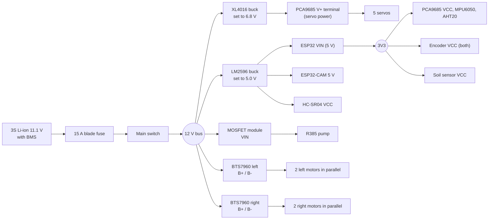

# Wiring

Pin numbers are ESP32 GPIO numbers and match `firmware/src/pins.h`.
Nothing in this document has been built and powered: check every connection
with a multimeter before plugging in the battery.

## Power tree



* **Set both buck converters with a multimeter before connecting anything
  to them.** 6.8 V on the servo rail is inside the rating of all three servo
  types (MG996R is the limit at 7.2 V).
* Solder a 1000 uF capacitor across the PCA9685 V+ / GND terminal and one
  across the 5 V rail next to the ESP32. Servo current spikes are what reset
  ESP32 boards.
* All grounds are common: battery negative, both bucks, both BTS7960 GND,
  PCA9685 GND, ESP32 GND.
* The e-stop described below is a **software** stop (it tells the firmware
  to cut motors, servos and pump). For a hard stop, put a second e-stop or a
  40 A automotive relay in the 12 V bus feeding the motor drivers and the
  servo buck.

### Current budget

| Load | Typical | Peak |
|---|---|---|
| 4 drive motors | 1.5 A total cruising | 9 A (four stalled, 2.3 A each) |
| 5 servos at 6.8 V (seen from 12 V) | 0.6 A | 5 A |
| Pump | 0.7 A | 1.8 A |
| Logic, camera, sensors | 0.35 A | 0.6 A |
| **Total from the battery** | **about 3 A** | **about 16 A** |

A 5200 mAh pack gives roughly 1.5 hours of mixed field work. The 15 A fuse
is below the worst-case stall sum on purpose: all four motors stalled plus
all servos stalled should blow it.

## ESP32 pin map

| GPIO | Direction | Connects to | Notes |
|---|---|---|---|
| 21 | I2C SDA | PCA9685, MPU6050, AHT20 | 4.7k pull-ups are already on the PCA9685 / GY-521 boards |
| 22 | I2C SCL | same | |
| 25 | out, PWM | BTS7960 **left** RPWM | 20 kHz |
| 26 | out, PWM | BTS7960 left LPWM | |
| 32 | out, PWM | BTS7960 **right** RPWM | |
| 33 | out, PWM | BTS7960 right LPWM | |
| 27 | out | R_EN + L_EN of **both** BTS7960 | high = drivers enabled |
| 18 | in | rear-left encoder A | encoder powered from 3V3 |
| 19 | in | rear-left encoder B | |
| 16 | in | rear-right encoder A | |
| 17 | in | rear-right encoder B | |
| 23 | out | HC-SR04 TRIG | |
| 39 (VN) | in | HC-SR04 ECHO **through a divider** | ECHO - 1k - GPIO39 - 2k - GND |
| 34 | analog in | soil sensor AOUT | sensor powered from 3V3 |
| 35 | analog in | battery divider | BAT+ - 33k - GPIO35 - 10k - GND (12.6 V -> 2.93 V) |
| 13 | out | MOSFET module trigger (pump) | |
| 14 | out | PCA9685 OE | low = servo outputs on |
| 15 | in, pull-up | e-stop NC contact to GND | open circuit = STOP, so a broken wire is safe |
| 2 | out | on-board LED | status |
| 4 | out | buzzer + | optional |
| VIN | power | 5 V from the LM2596 | never power VIN and USB from different supplies at once without a diode |

BTS7960 logic side: VCC -> ESP32 3V3, GND -> GND, R_IS / L_IS not connected.

Why these pins: 34/35/39 are input-only and belong to ADC1, which keeps
working while WiFi is on (ADC2 does not). 25/26/32/33 have no boot-strap
function. 16/17 are free on WROOM modules.

## PCA9685 channels

| Channel | Joint | Servo | Lead |
|---|---|---|---|
| 0 | base yaw | DS3218 270 deg | direct (servo sits in the deck) |
| 1 | shoulder | DS3235 180 deg | 30 cm extension |
| 2 | elbow | DS3218 270 deg | 50 cm extension |
| 3 | wrist | MG996R | 50 cm extension |
| 4 | gripper | MG996R | 30 + 50 cm extension |

Servo signal order on the PCA9685 headers is GND / V+ / PWM (brown / red /
orange).

## Encoder connector (JGB37-520, 6-pin)

Typical colour code, **which differs between batches: check the label on
your motor**: red = motor +, white = motor -, blue = encoder VCC,
black = encoder GND, yellow = A, green = B.

Wire encoder VCC to **3V3**, not 5 V, so that A / B never exceed the ESP32's
input rating.

## Motor polarity and direction

There is no way to know in advance which way a given motor turns. After
wiring, lift the robot off the ground and send `VEL 100 0` over serial:

* a side that turns backwards: swap that side's two motor wires at the
  BTS7960 (or flip `MOTOR_SIGN_L/R` in `firmware/src/hal_esp32.cpp`);
* odometry `x` counting down while the wheels turn forwards: swap that
  side's A and B (or flip `ENC_SIGN_L/R`).

## Where things go in the tray

Top view, front of the robot to the right. The perforated plate takes M3
nylon standoffs or zip ties anywhere on a 10 mm grid.

```
 rear                                                         front
 +----------------------------------------------------------------+
 | [motor RL]              [BTS7960 L]      [MOSFET] [PCA9685]  [motor FL] |
 |   e-stop                                                                |
 |   switch   [ battery 3S ]  [fuse] [MPU6050]   [ ESP32 ]                 |
 |   charge                                                                |
 | [motor RR]              [BTS7960 R]  [LM2596] [XL4016]       [motor FR] |
 +----------------------------------------------------------------+
```

Mount the MPU6050 flat, X arrow pointing to the front, near the centre.
